# 📖 TÀI LIỆU HƯỚNG DẪN SỬ DỤNG HỆ THỐNG QUẢN LÝ & ĐỐI SOÁT BƯU GỬI TỒN (TOOLS-BDLD)

> **Địa chỉ truy cập chính thức**: [https://tools.bdld.io.vn](https://tools.bdld.io.vn)  
> **Đơn vị quản lý & vận hành**: Bưu điện tỉnh Lâm Đồng (BCCP - VNPost)  
> **Phiên bản tài liệu**: 2.2 (Cập nhật chuẩn hóa toàn diện - Tháng 10/2026)

---

## 📑 MỤC LỤC CHI TIẾT

1. [Phần 1: Các Chức Năng Cơ Bản & Lưu Ý](#-phần-1-các-chức-năng-cơ-bản--lưu-ý)
   * 1.1. Địa chỉ truy cập hệ thống
   * 1.2. Hướng dẫn Đăng nhập & Đăng xuất
   * 1.3. Đồng bộ dữ liệu Power BI & Mẹo xử lý khi dữ liệu không hiển thị
2. [Phần 2: Dashboard Tổng Quan Hàng Tồn](#-phần-2-dashboard-tổng-quan-hàng-tồn)
   * 2.1. Khối thẻ thống kê KPI tổng hợp
   * 2.2. Cấu hình hiển thị bưu cục tồn & Lưu ý phạm vi Power BI
   * 2.3. Cấu hình mốc thời gian tồn hiển thị trên bảng Ma trận
   * 2.4. Vị trí các ô Highlight ngưỡng tồn & Bộ lọc Dashboard
   * 2.5. Vị trí nút Xem chi tiết bưu gửi của từng bưu cục
3. [Phần 3: Tra Cứu Chi Tiết Bưu Gửi Tồn](#-phần-3-tra-cứu-chi-tiết-bưu-gửi-tồn)
   * 3.1. Hướng dẫn xem Chi tiết bưu gửi tồn tại BĐT/TP Lâm Đồng
   * 3.2. Cấu hình thứ tự & Ẩn/Hiện cột hiển thị
   * 3.3. Chức năng bộ lọc & Giải thích chi tiết các trường tìm kiếm
   * 3.4. Chức năng Xuất Excel chi tiết & Nút Định vị nhanh
4. [Phần 4: Định Vị Bưu Gửi Đa Luồng (VNPost Trace)](#-phần-4-định-vị-bưu-gửi-đa-luồng-vnpost-trace)
   * 4.1. Giao diện tổng quan & Vị trí các thành phần
   * 4.2. Hướng dẫn chi tiết Quy trình tạo luồng & Cách nhập Captcha
   * 4.3. Luồng xử lý định vị toàn trình, Tiến trình & Tải file kết quả
5. [Phần 5: Mô-đun Đối Soát & Lọc Tồn Bưu Gửi](#-phần-5-mô-đun-đối-soát--lọc-tồn-bưu-gửi)
   * 5.1. Nạp 2 file dữ liệu đầu vào bắt buộc & Khởi chạy Lọc Tồn
   * 5.2. Thời gian xử lý & Màn hình hiệu ứng Animation trực quan
   * 5.3. Khối thẻ thống kê KPI kết quả đối soát
   * 5.4. Chi tiết 3 Bảng dữ liệu kết quả & Quy tắc phân loại nghiệp vụ
   * 5.5. Hướng dẫn sử dụng Toolbar bộ lọc phân loại & Quy tắc sắp xếp
   * 5.6. Xuất báo cáo đối soát Excel 3 Sheets chuẩn hóa
6. [Sơ Đồ Luồng Nghiệp Vụ Toàn Trình](#-sơ-đồ-luồng-nghiệp-vụ-toàn-trình)

---

## 🔐 PHẦN 1: CÁC CHỨC NĂNG CƠ BẢN & LƯU Ý

### 1.1. Địa Chỉ Truy Cập Hệ Thống
Người dùng mở trình duyệt web hiện đại (Google Chrome, Microsoft Edge, Cốc Cốc) và truy cập vào địa chỉ chính thức:
```text
https://tools.bdld.io.vn
```

---

### 1.2. Hướng Dẫn Đăng Nhập & Đăng Xuất

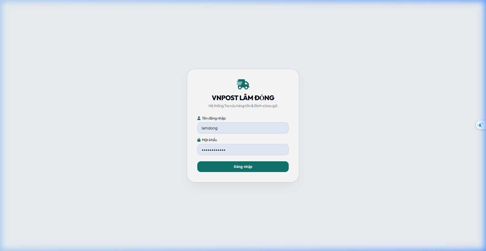

* **Bước 1 (Ô Tên đăng nhập)**: Nhập tên tài khoản được cấp phát cho đơn vị (ví dụ: `lamdong`).
* **Bước 2 (Ô Mật khẩu)**: Nhập mật khẩu bảo mật tương ứng.
* **Bước 3 (Nút Đăng nhập)**: Nhấn nút **Đăng nhập** màu xanh lá để truy cập vào hệ thống làm việc.
* **Đăng xuất**: 
  * Nằm ở góc dưới cùng bên trái thanh Menu Sidebar: Nhấn vào nút `[ 🚪 Đăng xuất ]`.
  * Sau khi đăng xuất, hệ thống sẽ xóa toàn bộ phiên làm việc cục bộ và chuyển hướng về màn hình đăng nhập.

> [!NOTE]
> Hệ thống hỗ trợ lưu phiên làm việc an toàn (Session Storage). Khi tắt tab và mở lại trên cùng trình duyệt, bạn không cần phải đăng nhập lại trừ khi đã bấm nút **Đăng xuất**.

---

### 1.3. Đồng Bộ Dữ Liệu Power BI & Mẹo Xử Lý Khi Dữ Liệu Không Hiển Thị

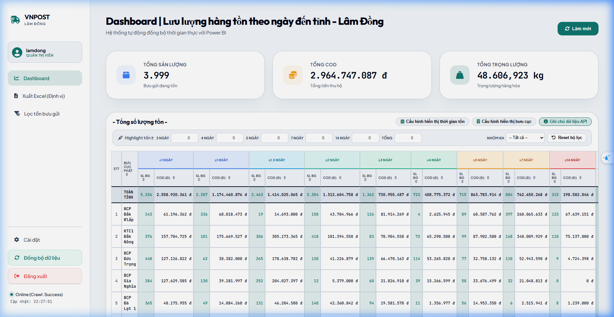

1. **Nút "Làm mới" dữ liệu**:
   * **Vị trí**: Nằm ở góc trên cùng bên phải màn hình Header (`[ 🔄 Làm mới ]`).
   * **Tác dụng**: Tải lại dữ liệu snapshot mới nhất từ máy chủ backend mà không làm mất trạng thái bộ lọc đang thao tác.
2. **Nút "Đồng bộ dữ liệu" (Power BI Sync)**:
   * **Vị trí**: Nằm ở góc dưới bên trái thanh Sidebar menu (`[ 🔄 Đồng bộ dữ liệu ]`).
   * **Tác dụng**: Gửi yêu cầu lên máy chủ crawler để quét và tải bản dữ liệu mới nhất trực tiếp từ báo cáo Power BI VNPost. Quá trình quét ngầm diễn ra trong khoảng 30 giây đến 1 phút.
   * **Đèn trạng thái (Status Dot)**: Nằm ngay dưới chân menu Sidebar:
     * 🟢 **Xanh lá (Online - Crawl: Success)**: Dữ liệu đang đồng bộ tốt và mới nhất.
     * 🟡 **Vàng (Đang đồng bộ...)**: Hệ thống crawler đang trong tiến trình cào dữ liệu từ Power BI.
     * 🔴 **Đỏ**: Lỗi kết nối hoặc URL Power BI cần kiểm tra.
3. **Mẹo xử lý khi màn hình không hiển thị dữ liệu hoặc dữ liệu cũ**:
   * **Cách 1**: Bấm nút **`[ 🔄 Làm mới ]`** ở góc trên bên phải.
   * **Cách 2**: Nhấn tổ hợp phím **`Ctrl + F5`** (hoặc `Shift + F5`) trên bàn phím để xóa sạch bộ nhớ đệm (cache) của trình duyệt.
   * **Cách 3**: Bấm nút **`[ 🔄 Đồng bộ dữ liệu ]`** ở góc dưới Sidebar, chờ khoảng 1 phút rồi tải lại trang.

---

## 📊 PHẦN 2: DASHBOARD TỔNG QUAN HÀNG TỒN


### 2.1. Khối Thẻ Thống Kê KPI Tổng Hợp (KPI Cards)
Nằm ngay dưới phần tiêu đề, cung cấp 3 chỉ số cốt lõi về tình hình lưu kho toàn tỉnh:
* 📦 **TỔNG SẢN LƯỢNG**: Tổng số lượng bưu gửi hiện đang lưu giữ tại tất cả các bưu cục trên địa bàn tỉnh Lâm Đồng.
* 💰 **TỔNG COD**: Tổng số tiền thu hộ COD cần bưu tá thu hồi nộp về quỹ.
* ⚖️ **TỔNG TRỌNG LƯỢNG**: Tổng khối lượng hàng hóa (kg) tồn đọng tại kho phát.

---

### 2.2. Cấu Hình Hiển Thị Bưu Cục Tồn & Lưu Ý Phạm Vi Power BI

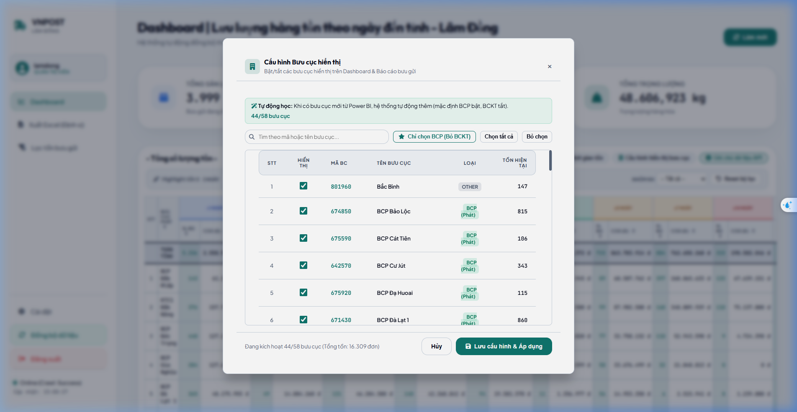

* **Vị trí nút bấm**: Nằm tại góc trên bên phải bảng ma trận: Nút `[ 🏢 Cấu hình hiển thị bưu cục ]`.
* **Cách thao tác**:
  1. **Ô tìm kiếm nhanh**: Nhập mã bưu cục (ví dụ: `670000`, `671040`) hoặc tên bưu cục để định vị nhanh dòng cần chỉnh.
  2. **Công tắc Bật/Tắt (Toggle Switch)**: Gạt bật công tắc màu xanh cho các bưu cục phát cần theo dõi; gạt tắt các bưu cục trung chuyển/khai thác không cần theo dõi.
  3. **Nút Lưu**: Nhấn **`[ 💾 Lưu cấu hình bưu cục ]`** ở góc dưới modal để lưu thiết lập vào LocalStorage của trình duyệt. Số liệu bảng ma trận sẽ tự động tính toán lại ngay lập tức.

> [!IMPORTANT]
> **Lưu ý về Phạm vi thu thập dữ liệu từ Power BI**:
> * Hệ thống chỉ thu thập và tổng hợp dữ liệu cho các bưu cục thuộc danh mục của **Bưu điện tỉnh Lâm Đồng (đầu mã 67xxxx)** và các bưu cục được kích hoạt bật hiển thị.
> * Các bưu cục ngoại tỉnh hoặc bưu cục bị tắt trong bảng cấu hình sẽ tự động được loại trừ khỏi thống kê tổng hợp nhằm đảm bảo số liệu sát đúng thực tế nghiệp vụ của đơn vị.

---

### 2.3. Cấu Hình Mốc Thời Gian Tồn Hiển Thị Trên Bảng Ma Trận

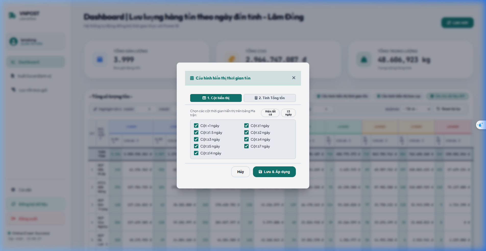

* **Vị trí nút bấm**: Nằm tại góc trên bên phải bảng ma trận: Nút `[ 📅 Cấu hình hiển thị thời gian tồn ]`.
* **Giao diện Modal gồm có**:
  1. **Tiêu đề**: "Cấu hình hiển thị thời gian tồn".
  2. **Hai nút thao tác nhanh**:
     * `[ Hiện tất cả ]`: Bật hiển thị tất cả 9 mốc thời gian tồn.
     * `[ ≥3 ngày* ]`: Chọn nhanh các mốc từ 3 ngày trở lên (chuẩn theo dõi trọng điểm).
  3. **Lưới danh sách checkbox các mốc ngày tồn**:
     * `Cột <1 ngày`: Bưu gửi mới đến trong ngày.
     * `Cột ≥1 ngày`: Tồn từ 1 ngày.
     * `Cột ≥1.5 ngày`: Tồn từ 1.5 ngày.
     * `Cột ≥2 ngày`: Tồn từ 2 ngày.
     * `Cột ≥3 ngày`: Tồn từ 3 ngày.
     * `Cột ≥4 ngày`: Tồn từ 4 ngày.
     * `Cột ≥5 ngày`: Tồn từ 5 ngày.
     * `Cột ≥7 ngày`: Tồn từ 7 ngày (tồn 1 tuần).
     * `Cột ≥14 ngày`: Tồn từ 14 ngày trở lên (tồn nghiêm trọng quá hạn).
  4. **Nút điều khiển chân Modal**:
     * Nút `[ Hủy ]`: Đóng modal và không lưu thay đổi.
     * Nút `[ 💾 Lưu & Áp dụng ]`: Lưu cấu hình và cập nhật số lượng cột của bảng ma trận ngay lập tức.

---

### 2.4. Vị Trí Các Ô Highlight Ngưỡng Tồn & Bộ Lọc Dashboard

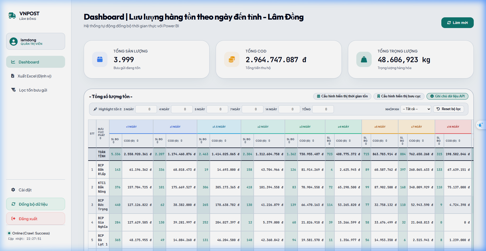

Thanh công cụ nằm ngay phía trên bảng ma trận tổng hợp, bao gồm đầy đủ các vị trí sau:
1. **Các ô nhập ngưỡng Highlight tồn (`Highlight tồn ≥`)**:
   * Bao gồm các ô nhập số nguyên cho từng mốc: `3 NGÀY`, `4 NGÀY`, `5 NGÀY`, `7 NGÀY`, `14 NGÀY`, và `TỔNG`.
   * **Tác dụng**: Người dùng nhập số lượng tồn cảnh báo cho từng mốc (ví dụ: nhập `50` vào ô 3 ngày, `10` vào ô 14 ngày). Bất kỳ bưu cục nào có số lượng tồn thực tế **lớn hơn hoặc bằng** con số ngưỡng này, ô số liệu tại cột tương ứng sẽ tự động được **đổi màu nổi bật (Highlight màu vàng cam hoặc đỏ)**. Giúp lãnh đạo và cán bộ điều hành phát hiện ngay bưu cục đang có nguy cơ ùn ứ hàng hóa.
2. **Vị trí Dropdown Lọc "NHÓM KH"**:
   * Nằm ở phía bên phải thanh công cụ.
   * Hỗ trợ lọc tức thì số liệu ma trận theo từng phân khúc khách hàng:
     * `-- Tất cả --`: Toàn bộ sản lượng.
     * `KH Mới`: Khách hàng mới phát sinh bưu gửi.
     * `KH Shopee`: Bưu gửi từ sàn TMĐT Shopee.
     * `KH Thường`: Khách hàng lẻ / truyền thống.
     * `KH Tiktok`: Bưu gửi từ sàn TMĐT TikTok Shop.
     * `KH Trọng điểm`: Khách hàng lớn có thỏa thuận SLA đặc biệt.
3. **Vị trí Nút "Reset bộ lọc" (`[ 🔄 Reset bộ lọc ]`)**:
   * Nằm ngay cạnh dropdown Nhóm KH.
   * Nhấn nút này để xóa trắng toàn bộ các ô nhập ngưỡng highlight và đưa dropdown Nhóm KH về trạng thái `-- Tất cả --`.
4. **Vị trí bộ lọc Bưu cục trên Dashboard**:
   * Lọc hiển thị danh sách bưu cục thông qua nút `[ 🏢 Cấu hình hiển thị bưu cục ]` (như đã hướng dẫn ở mục 2.2).
   * Lọc xem nhanh chi tiết từng bưu cục bằng cách nhấp trực tiếp vào tên bưu cục hoặc biểu tượng mũi tên ở dòng tương ứng.

---

### 2.5. Vị Trí Nút Xem Chi Tiết Bưu Gửi Của Từng Bưu Cục
Tại mỗi dòng của Bảng ma trận tổng hợp:
* **Cách 1**: Nhấp chuột trực tiếp vào **Tên bưu cục** ở cột thứ 2.
* **Cách 2**: Nhấp vào biểu tượng mũi tên chi tiết ở cuối dòng bưu cục đó.
* **Tác dụng**: Màn hình làm việc sẽ tự động cuộn xuống phần **"2/ Chi tiết bưu gửi tồn tại BĐT/TP Lâm Đồng"** và áp dụng sẵn điều kiện lọc riêng cho bưu cục vừa được nhấp chọn.

---

## 📦 PHẦN 3: TRA CỨU CHI TIẾT BƯU GỬI TỒN

### 3.1. Hướng Dẫn Xem Chi Tiết Bưu Gửi Tồn Tại BĐT/TP Lâm Đồng

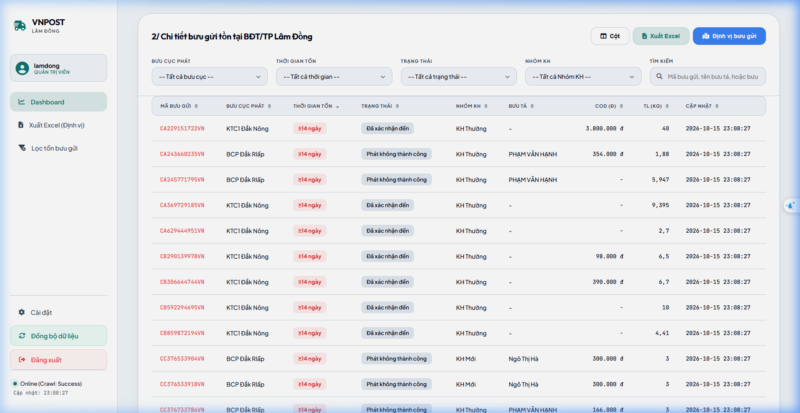

Nằm ở nửa dưới màn hình Dashboard, cung cấp thông tin chi tiết đến từng số hiệu bưu gửi cụ thể:
* **Mã bưu gửi**: Số hiệu tra cứu bưu gửi (ItemCode), chữ số màu đỏ nổi bật.
* **Bưu cục phát**: Tên bưu cục đang lưu kho chịu trách nhiệm phát hàng.
* **Thời gian tồn**: Mốc thời gian lưu trữ tính từ ngày đến bưu cục (`≥14 ngày`, `≥7 ngày`...).
* **Trạng thái**: Trạng thái ghi nhận trên hệ thống (ví dụ: `Đã xác nhận đến`, `Phát không thành công`, `Giao bưu tá`...).
* **Nhóm KH**: Phân loại đối tượng khách hàng gửi hàng.
* **Bưu tá**: Họ tên nhân viên bưu tá phụ trách tuyến phát.
* **COD (đ)**: Số tiền thu hộ COD bằng chữ số định dạng rõ ràng.
* **TL (kg)**: Khối lượng hàng hóa thực tế.
* **Cập nhật**: Thời gian ghi nhận dữ liệu lần cuối.
* **Thanh phân trang**: Cho phép chuyển trang nhanh và tùy chỉnh xem 15, 30, 50 hoặc 100 dòng trên một trang.

---

### 3.2. Cấu Hình Thứ Tự & Ẩn/Hiện Cột Hiển Thị

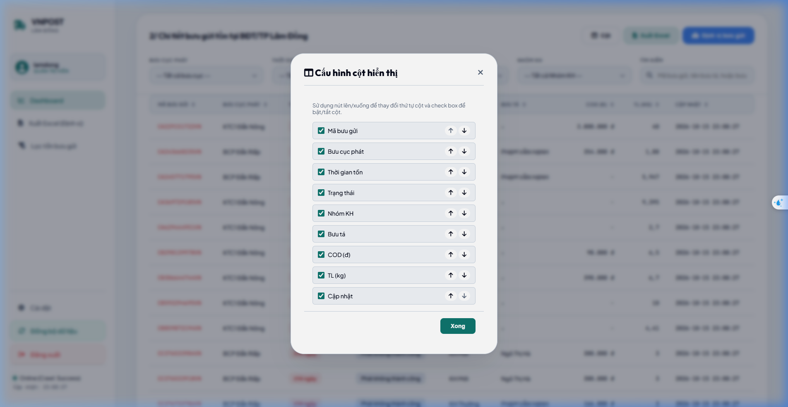

* **Vị trí nút bấm**: Nằm tại thanh tác vụ phía trên bảng chi tiết: Nút `[ 📋 Cột ]`.
* **Cách thao tác**:
  1. **Ẩn / Hiện cột (Checkbox)**: Đánh dấu tick `☑` vào cột muốn xem; bỏ tick `☐` ở những cột không quan trọng để bảng hiển thị rộng rãi, thoáng mắt.
  2. **Thay đổi thứ tự hiển thị (Nút Mũi tên `↑` `↓`)**: Nhấn nút mũi tên hướng lên hoặc hướng xuống tương ứng với từng cột để di chuyển cột đó sang trái hoặc sang phải trong bảng theo đúng thói quen theo dõi của bạn.
  3. **Nút "Xong"**: Nhấn nút `[ Xong ]` màu xanh lá ở góc dưới bên phải modal để lưu cấu hình. Cấu hình được ghi nhớ vĩnh viễn trên trình duyệt của bạn.

---

### 3.3. Chức Năng Bộ Lọc & Giải Thích Chi Tiết Các Trường Tìm Kiếm

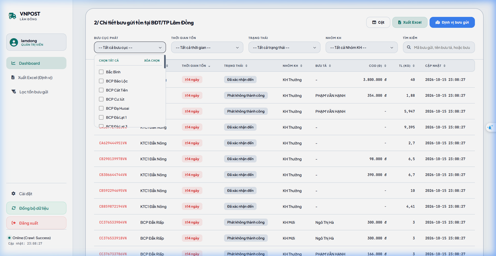

Thanh bộ lọc thông minh (`Filters Container`) hỗ trợ kết hợp đa điều kiện cùng lúc:

| Tên trường lọc | Loại điều khiển | Giải thích ý nghĩa & Cách sử dụng |
| :--- | :--- | :--- |
| **Bưu cục phát** | Multiselect Dropdown | Cho phép chọn một hoặc nhiều bưu cục cùng lúc. Bấm mở dropdown sẽ có 2 nút tiện ích: **`Chọn tất cả`** và **`Xóa chọn`**, bên dưới là danh sách checkbox của toàn bộ các bưu cục trên địa bàn tỉnh Lâm Đồng. |
| **Thời gian tồn** | Multiselect Dropdown | Đa chọn mốc thời gian tồn cần truy vấn: `≥3 ngày`, `≥4 ngày`, `≥5 ngày`, `≥7 ngày`, `≥14 ngày`. |
| **Trạng thái** | Multiselect Dropdown | Đa chọn trạng thái hàng hóa: `Đã xác nhận đến`, `Phát không thành công`, `Giao bưu tá`, `Chờ phát lại`... |
| **Nhóm KH** | Multiselect Dropdown | Lọc theo các nhóm khách hàng: `KH Shopee`, `KH Tiktok`, `KH Trọng điểm`, `KH Mới`, `KH Thường`. |
| **Tìm kiếm** | Ô nhập văn bản tự do | Nhập tự do Số hiệu bưu gửi (ItemCode), Họ tên bưu tá phát hàng, hoặc Số điện thoại người nhận. Dữ liệu bảng sẽ lọc tức thì theo từng ký tự gõ vào. |

---

### 3.4. Chức Năng Xuất Excel Chi Tiết & Nút Định Vị Nhanh


Nằm ở góc trên bên phải của bảng chi tiết gồm 3 nút chức năng quan trọng:
1. **Nút "Xuất Excel" (`[ 📗 Xuất Excel ]`)**:
   * Xuất toàn bộ danh sách bưu gửi đang hiển thị (sau khi đã lọc theo điều kiện mong muốn) ra file Excel định dạng chuẩn `hangton.xlsx`.
   * **Tác dụng cốt lõi**: File này là danh sách để gửi cho các bưu cục rà soát xử lý, đồng thời **là File đầu vào số 1 bắt buộc** cho mô-đun [Lọc Tồn bưu gửi ở Phần 5](#-phần-5-mô-đun-đối-soát--lọc-tồn-bưu-gửi).
2. **Nút "Định vị bưu gửi" (`[ 📍 Định vị bưu gửi ]`)**:
   * Tự động lấy toàn bộ danh sách mã bưu gửi đang lọc và chuyển thẳng sang màn hình **Xuất Excel Định vị (Phần 4)**. Người dùng không cần phải copy - paste thủ công từng mã bưu gửi.

---

## 🎯 PHẦN 4: ĐỊNH VỊ BƯU GỬI ĐA LUỒNG (VNPOST TRACE)

Mô-đun định vị kết nối trực tiếp với cổng thông tin nội bộ của VNPost để quét hành trình phát thực tế của hàng nghìn bưu gửi cùng lúc với tốc độ cao.

### 4.1. Giao Diện Tổng Quan & Vị Trí Các Thành Phần

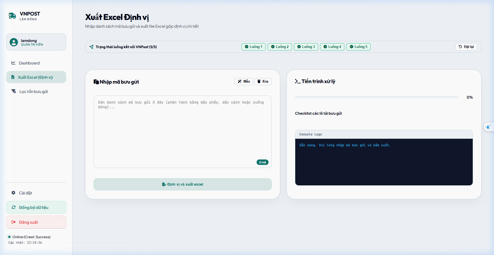

Người dùng chuyển sang tab **"Xuất Excel (Định vị)"** trên Sidebar Menu. Màn hình gồm 4 khu vực chính:
1. **Thanh trạng thái luồng kết nối VNPost (`Compact Thread Bar`)**:
   * Hiển thị số lượng luồng kết nối đang sẵn sàng (ví dụ: `Luồng 1`, `Luồng 2`, `Luồng 3`, `Luồng 4`, `Luồng 5`).
   * Nút **`[ 🔄 Đặt lại ]`**: Dùng để reset toàn bộ session các luồng và tải lại Captcha mới khi cần.
2. **Khung nhập danh sách mã bưu gửi (Bên trái)**:
   * Vùng văn bản `Textarea` cho phép dán danh sách mã bưu gửi (phân tách bằng dấu xuống dòng, dấu phẩy hoặc dấu cách).
   * Badge đếm số lượng mã tự động (ví dụ: `3 mã`, `1.500 mã`).
   * Nút `[ 🪄 Mẫu ]`: Nạp nhanh 3 mã bưu gửi mẫu để thử nghiệm kết nối.
   * Nút `[ 🗑️ Xóa ]`: Xóa sạch nội dung trong ô nhập.
3. **Nút kích hoạt tiến trình (`[ ⚡ Định vị và xuất excel ]`)**:
   * Nút bấm lớn màu xanh lá nằm ngay dưới khung nhập mã.
4. **Khung tiến trình & Nhật ký (Bên phải)**:
   * Thanh tiến trình phần trăm (`Progress Bar` từ 0% đến 100%).
   * Checklist các lô tải bưu gửi (`Batch Checklist`).
   * Cửa sổ dòng lệnh `Console Logs` hiển thị thông tin phản hồi thời gian thực từ máy chủ VNPost.

---

### 4.2. Hướng Dẫn Chi Tiết Quy Trình Tạo Luồng & Cách Nhập Captcha


Để ngăn chặn việc máy chủ VNPost khóa kết nối tự động, hệ thống sử dụng cơ chế xác thực phiên làm việc bằng Captcha qua từng luồng:

* **Khi nào cần nhập Captcha?**:
  * Khi mở màn hình lần đầu hoặc khi một luồng hiển thị trạng thái màu vàng/đỏ (Chưa kích hoạt hoặc hết hạn phiên).
  * Hoặc khi người dùng nhấn nút **`[ 🔄 Đặt lại ]`**.
* **Cách mở form Captcha**:
  * Nhấp chuột trực tiếp vào biểu tượng luồng chưa sẵn sàng trên thanh trạng thái (ví dụ: nhấp vào nút `Luồng 1`).
  * Khung giải Captcha (`#session-captcha-form`) sẽ mở rộng ngay bên dưới thanh trạng thái.
* **Các thành phần trong Form Captcha**:
  * **Tiêu đề**: "Giải Captcha Luồng X".
  * **Ảnh Captcha**: Hiển thị hình ảnh mã xác thực ngẫu nhiên từ hệ thống VNPost.
  * **Nút Tải lại Captcha (`🔄`)**: Bấm nút này nếu ảnh bị mờ, méo hoặc khó đọc để lấy ảnh mới.
  * **Ô nhập mã (`Nhập mã...`)**: Nhập chính xác các ký tự chữ và số nhìn thấy trên ảnh Captcha.
  * **Nút `[ Xác nhận ]`**: Gửi mã vừa nhập lên máy chủ để mở khóa phiên làm việc.
  * **Nút `[ Hủy ]`**: Đóng form Captcha.
* **Kết quả**: Khi nhập đúng mã Captcha, luồng tương ứng sẽ chuyển sang **màu xanh lá (Sẵn sàng)**. Bạn có thể giải tiếp các luồng 2, 3, 4, 5 để tăng tốc độ định vị gấp nhiều lần.

---

### 4.3. Luồng Xử Lý Định Vị Toàn Trình, Tiến Trình & Tải File Kết Quả


Quy trình vận hành định vị bưu gửi diễn ra theo các bước:

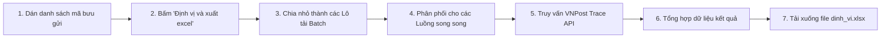

1. **Bước 1 - Chuẩn bị mã**: Dán danh sách mã bưu gửi vào ô nhập (hoặc được chuyển tự động từ nút Định vị ở Phần 3).
2. **Bước 2 - Bắt đầu quét**: Nhấn nút **`[ ⚡ Định vị và xuất excel ]`**.
3. **Bước 3 - Theo dõi tiến trình**:
   * Hệ thống tự động chia danh sách mã thành các lô (batch, mỗi batch từ 20 đến 50 mã).
   * Các luồng đã giải Captcha sẽ đồng thời truy vấn thông tin hành trình từ VNPost.
   * Thanh Progress Bar tăng dần từ 0% đến 100%. Checklist hiển thị từng lô hoàn thành (Lô 1, Lô 2, Lô 3...).
   * Cửa sổ Console Logs ghi nhận chi tiết: *`[11:20:19 PM] Luồng 1 đang tải Lô 1/1... Hoàn tất! Xuất thành công 3/3 bưu gửi.`*
4. **Bước 4 - Tải xuống file Excel định vị**:
   * Khi tiến trình đạt 100%, nút màu xanh lá nổi bật **`[ 📥 TẢI XUỐNG FILE EXCEL ĐỊNH VỊ ]`** sẽ tự động xuất hiện.
   * Nhấp vào nút để lưu file Excel kết quả về máy tính (mặc định tên file là `dinh_vi.xlsx`).
   * File này chứa 2 cột thông tin cốt lõi quan trọng nhất: **Vị trí cuối cùng** và **Trạng thái cuối cùng** (**File đầu vào số 2 bắt buộc** cho mô-đun [Lọc Tồn ở Phần 5](#-phần-5-mô-đun-đối-soát--lọc-tồn-bưu-gửi)).

---

## 🔄 PHẦN 5: MÔ-ĐUN ĐỐI SOÁT & LỌC TỒN BƯU GỬI

Đây là mô-đun quan trọng nhất của hệ thống, giúp tự động đối soát in-memory giữa danh sách **Hàng Tồn** (trích xuất từ Power BI) và danh sách **Định Vị** (trích xuất từ cổng hành trình thực tế VNPost) để bóc tách chính xác hàng tồn thực tế tại các bưu cục phát.

### 5.1. Nạp 2 File Dữ Liệu Đầu Vào Bắt Buộc & Khởi Chạy Lọc Tồn


Người dùng chuyển sang tab **"Lọc tồn bưu gửi"** trên thanh menu Sidebar. Tại đây có 2 vùng nạp file:
* **Vùng 1 (Hộp bên trái - Màu xanh ngọc)**: `1. File Hàng Tồn (hangton.xlsx)`. Kéo thả file Excel xuất từ Phần 3 vào đây hoặc bấm để chọn file từ máy tính.
* **Vùng 2 (Hộp bên phải - Màu xanh dương)**: `2. File Định Vị (dinh_vi.xlsx)`. Kéo thả file Excel xuất từ Phần 4 vào đây hoặc bấm để chọn file từ máy tính.
* Khi nạp thành công, trên mỗi hộp sẽ hiện tên file và badge màu xanh xác nhận.
* **Nút bấm điều khiển**:
  * **`[ ⚡ Bắt đầu Lọc Tồn ]`**: Nhấn nút để bắt đầu tiến trình đối soát.
  * **`[ 🔄 Làm mới ]`**: Nhấn để xóa trắng 2 file vừa nạp và làm lại từ đầu.

---

### 5.2. Thời Gian Xử Lý & Màn Hình Hiệu Ứng Animation Trực Quan


* **Thời gian xử lý cực nhanh**: Nhờ thuật toán đối soát in-memory trực tiếp trên trình duyệt bằng JavaScript, hệ thống chỉ mất từ **1 đến 3 giây** để so khớp và phân loại hàng chục nghìn bưu gửi mà không cần tải lên máy chủ bên thứ ba.
* **Màn hình hiệu ứng Animation 4 giai đoạn**: Trong 1-3 giây xử lý, màn hình sẽ hiển thị vòng xoay tiến trình công nghệ cao (Orbit Spinner) và thanh tiến trình Shimmer chạy qua 4 mốc rõ ràng:
  1. `1. File Định vị`: Đọc và trích xuất danh sách mã số hiệu, trạng thái và vị trí cuối cùng.
  2. `2. File Hàng tồn`: Đọc và trích xuất danh sách bưu gửi tồn theo bưu cục.
  3. `3. Đối soát mã`: Khớp mã số hiệu (INNER JOIN) và phân loại theo quy tắc nghiệp vụ Lâm Đồng.
  4. `4. Tổng hợp BC`: Tính toán ma trận số liệu tổng hợp cho toàn tỉnh và từng bưu cục.

---

### 5.3. Khối Thẻ Thống Kê KPI Kết Quả Đối Soát

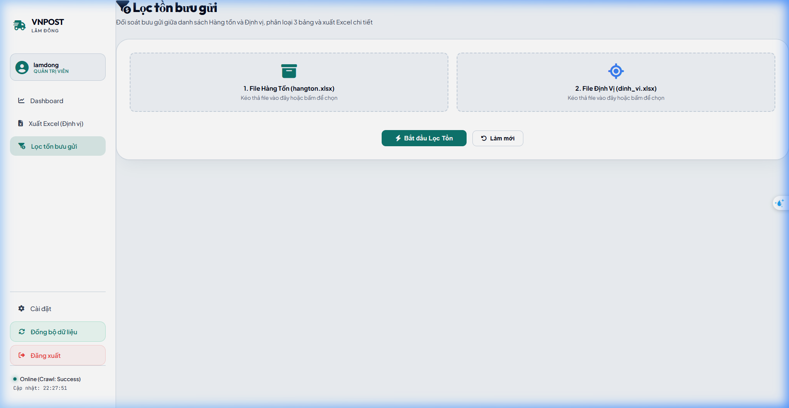

Ngay sau khi quá trình đối soát hoàn tất, hệ thống hiển thị ngay 4 thẻ KPI tổng kết:
* 📦 **Tổng bưu gửi**: Tổng số bưu gửi có trong file hàng tồn gốc đưa vào.
* ⚠️ **Bảng 1: Chưa phát**: Số lượng bưu gửi **chưa phát thành công** (đây chính là hàng tồn thực tế cần xử lý gấp).
* 📋 **Bảng 2: Danh sách bg trạng thái khác**: Số lượng bưu gửi đã phát thành công, đã thu tiền hoặc đã điều tin chuyển tiếp ra ngoại tỉnh.
* 🏢 **Bảng 3: Số bưu cục**: Tổng số bưu cục phát có phát sinh bưu gửi tồn.

---

### 5.4. Chi Tiết 3 Bảng Dữ Liệu Kết Quả & Quy Tắc Phân Loại Nghiệp Vụ

Dữ liệu được tổ chức khoa học thành **3 Tabs chuyên biệt**:

#### 🏢 Bảng 3: Tổng Hợp Bưu Cục Tồn (Tab Mặc Định)
* **Ý nghĩa**: Báo cáo tổng thể tình hình tồn đọng bưu gửi theo từng bưu cục phục vụ báo cáo ban giám đốc và các phòng nghiệp vụ.
* **Dòng đầu tiên đặc biệt (★ TOÀN TỈNH LÂM ĐỒNG)**: Dòng tổng kết toàn bộ số liệu của tất cả bưu cục trên địa bàn tỉnh với nền màu xanh ngọc nổi bật.
* **Các cột số liệu chi tiết**:
  * `Mã BC` & `Tên bưu cục phát`.
  * `SL Tồn 3N` & `Tiền COD 3N`: Bưu gửi tồn mốc 3 ngày.
  * `SL Tồn 5N` & `Tiền COD 5N`: Bưu gửi tồn mốc 5 ngày.
  * `SL Tồn 7N` & `Tiền COD 7N`: Bưu gửi tồn mốc 7 ngày.
  * `SL Tồn 14N` & `Tiền COD 14N`: Bưu gửi tồn quá hạn từ 14 ngày trở lên.
  * `Tổng tồn` & `Tổng tiền COD`: Tổng số bưu gửi và tiền COD thực tế đang lưu tại bưu cục.

#### ⚠️ Bảng 1: Chưa Phát Thành Công (Hàng Tồn Thực Tế Cần Bưu Tá Xử Lý)


* **Ý nghĩa**: Danh sách chi tiết từng bưu gửi **thực sự đang tồn đọng tại kho** mà bưu tá chưa phát được cho khách hàng.
* **⭐ QUY TẮC NGHIỆP VỤ ĐẶC BIỆT CỦA BẢNG 1**:
  * Các bưu gửi mang trạng thái `[BĐ8]Đã xác nhận đi` hoặc `Đã đóng chuyến thư đi` nhưng có **Vị trí cuối cùng ở các bưu cục có 2 số đầu là `64` (Đắk Nông), `67` (Lâm Đồng) hoặc `80` (Bình Thuận)** thì:
    1. **BẮT BUỘC LIỆT KÊ LẠI VÀO BẢNG 1 (HÀNG TỒN THỰC TẾ)**, vì hàng hóa vẫn đang luân chuyển nội bộ trong phạm vi địa bàn quản lý.
    2. Tên trạng thái của các bưu gửi này được tự động định danh lại theo công thức:
       $$\text{Tên trạng thái hiển thị} = \text{[Trạng thái cuối cùng]} - \text{[Vị trí cuối cùng]}$$
       *(Ví dụ: `[BĐ8]Đã xác nhận đi - BCP Đức Trọng`, `Đã đóng chuyến thư đi - KTC1 Đắk Nông`)*.

#### 📋 Bảng 2: Danh Sách Bưu Gửi Trạng Thái Khác
* **Ý nghĩa**: Danh sách các bưu gửi đã được giải tỏa khỏi kho tồn nhưng file tồn nguồn cũ chưa kịp gạch nợ:
  * Bưu gửi có trạng thái: `Đã phát thành công` / `Phát thành công`.
  * Bưu gửi có trạng thái: `Đã thu tiền bưu tá` / `Đã thu tiền khách hàng`.
  * Bưu gửi có trạng thái: `Đã trả tiền cho người gửi` / `Mất bưu gửi`.
  * Các bưu gửi mang trạng thái `[BĐ8]Đã xác nhận đi` hoặc `Đã đóng chuyến thư đi` nhưng có **Vị trí cuối cùng thuộc các tỉnh khác** (không thuộc 64, 67, 80).

---

### 5.5. Hướng Dẫn Sử Dụng Toolbar Bộ Lọc Phân Loại & Quy Tắc Sắp Xếp

Thanh Toolbar bộ lọc nằm ngay phía trên bảng dữ liệu kết quả gồm 5 tiêu chí lọc:
1. **Bưu cục phát**: Dropdown chọn riêng từng bưu cục phát để xuất danh sách đôn đốc riêng cho bưu cục đó.
2. **Thời gian tồn**: Lọc theo các mốc tồn cụ thể (`≥14 ngày`, `≥7 ngày`, `≥5 ngày`, `≥3 ngày`).
3. **Trạng thái định vị**: Dropdown đã được chuẩn hóa thông minh; các trạng thái chuyển tiếp được gom về đúng 2 nhóm gốc: `[BĐ8]Đã xác nhận đi` và `Đã đóng chuyến thư đi` (không bị chia rẽ nhỏ theo từng bưu cục trên danh sách lọc, giúp người dùng chọn lọc dễ dàng).
4. **Tiền COD**: Lọc bưu gửi `Có COD`, `Không COD`, `COD ≥ 1 triệu`, `COD ≥ 5 triệu`.
5. **Tìm nhanh**: Nhập số hiệu bưu gửi, họ tên bưu tá để tìm kiếm tức thì.
6. **Nút `[ ✕ Bỏ lọc ]`**: Xóa nhanh các điều kiện lọc đang chọn.

> [!TIP]
> **Quy tắc Sắp xếp Dữ liệu Tự động (Mặc định)**:
> Toàn bộ danh sách bưu gửi trong Bảng 1 và Bảng 2 luôn được hệ thống tự động sắp xếp ưu tiên theo 3 tầng nghiệp vụ:
> 1. **Thời gian tồn giảm dần**: Bưu gửi tồn lâu ngày nhất (≥14 ngày, ≥7 ngày...) luôn được đưa lên đầu danh sách để xử lý trước.
> 2. **Tiền COD giảm dần**: Các bưu gửi có số tiền thu hộ COD lớn nhất được ưu tiên xếp trước để bưu tá thu hồi tiền nhanh.
> 3. **Mã bưu cục**: Gom nhóm theo từng đơn vị bưu cục phát.

---

### 5.6. Xuất Báo Cáo Đối Soát Excel 3 Sheets Chuẩn Hóa

* **Vị trí nút bấm**: Nằm ở góc trên cùng bên phải Header mô-đun Lọc Tồn: Nút **`[ 📗 Xuất File Excel (3 Sheets) ]`**.
* **Thao tác**: Nhấp vào nút, trình duyệt sẽ tự động tải về file Excel hoàn chỉnh có tên định dạng:
  ```text
  Loc_ton_YYYY-MM-DD.xlsx
  ```
* **Cấu trúc 3 Sheets trong file Excel**:
  1. **Sheet 1 (`Tổng tồn các BC`)**: Bảng báo cáo tổng hợp số lượng và tiền COD theo các mốc 3N, 5N, 7N, 14N của tất cả các bưu cục và dòng Tổng toàn tỉnh.
  2. **Sheet 2 (`Danh sách bưu gửi tồn`)**: Chi tiết toàn bộ bưu gửi thuộc **Bảng 1 (Chưa phát thành công)** kèm đầy đủ thông tin: Mã bưu gửi, Bưu cục phát, Thời gian tồn, Trạng thái (đã ghép vị trí cuối cùng), Bưu tá, Tiền COD, Trọng lượng.
  3. **Sheet 3 (`Danh sách bg trạng thái khác`)**: Chi tiết toàn bộ bưu gửi thuộc **Bảng 2** đã phát thành công hoặc chuyển đi ngoại tỉnh.

---

## 🗺️ SƠ ĐỒ LUỒNG NGHIỆP VỤ TOÀN TRÌNH

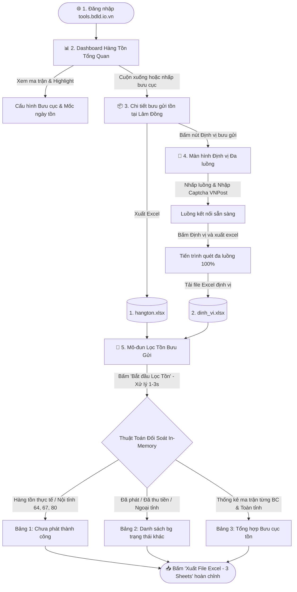

---

> [!TIP]
> **Hỗ trợ kỹ thuật & Đóng góp ý kiến**: Mọi câu hỏi thắc mắc hoặc yêu cầu hỗ trợ trong quá trình sử dụng hệ thống, xin vui lòng liên hệ Bộ phận CNTT - Bưu điện tỉnh Lâm Đồng để được giải đáp kịp thời.
