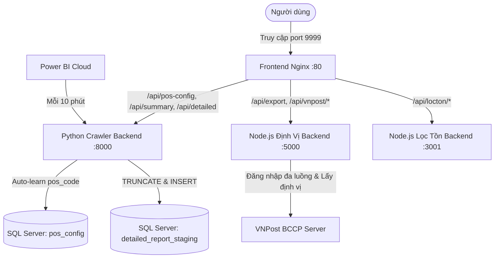

# Tool BDLD VNP (Bưu điện Lâm Đồng - VNPost)

Hệ thống quản lý, giám sát hàng tồn và tra cứu định vị bưu gửi chuyên biệt cho **Bưu điện tỉnh Lâm Đồng (VNPost)**. Tích hợp tự động crawl dữ liệu thời gian thực từ Power BI, hỗ trợ học tự động danh mục bưu cục, phân loại hàng tồn, đối soát lọc tồn bưu gửi và định vị bưu gửi đa luồng song song qua hệ thống VNPost BCCP.

---

## 🚀 Các tính năng nổi bật

- 📊 **Dashboard Giám sát Hàng Tồn Thời Gian Thực:**
  - Tự động đồng bộ dữ liệu snapshot từ Power BI của Tổng công ty mỗi **10 phút**.
  - Tự động bóc tách và phân loại theo các khoảng thời gian tồn: `≥3 ngày`, `≥4 ngày`, `≥5 ngày`, `≥7 ngày`, `≥14 ngày`.
  - Tùy biến linh hoạt các cột thời gian tham gia tính **Tổng tồn toàn tỉnh**.
  - Đánh dấu màu nổi bật (Highlight) tự động theo ngưỡng số lượng bưu gửi tồn.

- 📑 **Lọc Tồn Bưu Gửi & Đối Soát Báo Cáo (Mới):**
  - Tải lên 2 file dữ liệu: File Hàng tồn (`hangton.xlsx`) và File Định vị (`dinh_vi.xlsx`).
  - Tự động đối soát mã bưu gửi in-memory với hiệu năng cao, phân loại tự động thành **3 bảng dữ liệu**:
    - **Bảng 1 (Danh sách bưu gửi tồn):** Các bưu gửi chưa phát thành công hoặc có lý do tồn đọng thực tế.
    - **Bảng 2 (Danh sách trạng thái khác):** Các bưu gửi đã giao thành công, đã thu tiền khách hàng/bưu tá, hoặc bưu cục trung chuyển đã đóng chuyến thư chuyển tiếp.
    - **Bảng 3 (Tổng hợp bưu cục):** Bảng tổng hợp số lượng bưu gửi và tổng tiền COD theo các mốc 3N, 5N, 7N, 14N cho từng bưu cục và dòng tổng kết Toàn tỉnh Lâm Đồng.
  - Hỗ trợ xem trực quan trên Web (phân trang, lọc tìm kiếm nhanh theo mã/tên bưu cục) và xuất file Excel 3 sheets định dạng chuẩn chỉ với 1 click.

- 🏢 **Cơ chế Tự Động Học Bưu Cục Mới (Auto-learning POS):**
  - Tự động nhận diện bưu cục mới xuất hiện khi cào dữ liệu từ Power BI và lưu vào bảng `pos_config`.
  - **Quy tắc phân loại tự động:**
    - Bưu cục phát (`BCP...`): Tự động bật hiển thị (`is_active = 1`).
    - Bưu cục khai thác/trung chuyển (`BCKT...`): Tự động tắt hiển thị (`is_active = 0`).
  - **Bảo toàn cấu hình người dùng:** Hệ thống không ghi đè trạng thái bật/tắt mà người quản trị đã tùy chỉnh.
  - **Bộ lọc hiển thị toàn diện:** Dashboard, KPI tổng quan, bộ lọc dropdown và file xuất báo cáo chỉ hiển thị các bưu cục đang được kích hoạt.
  - **Giao diện cấu hình trực quan:** Tích hợp nút thao tác nhanh `[ 🏢 Cấu hình hiển thị bưu cục ]` trên Dashboard và Tab riêng trong trang Cài đặt.

- 🔍 **Chi tiết Bưu Cục Khai Thác & Trung Chuyển (BCKT Explorer):**
  - Cung cấp cửa sổ tra cứu riêng cho các bưu cục khai thác (KTC1, BCKT, KHL, GD).
  - Thống kê sản lượng và danh sách mã bưu gửi (`item_code`) chi tiết, giải thích nguyên nhân đọng ở khâu khai thác hoặc thiếu thông tin bưu tá.

- 🧵 **Tra Cứu Định Vị Bưu Gửi Đa Luồng (VNPost Multi-Session):**
  - Hỗ trợ tải dữ liệu định vị hàng ngàn bưu gửi đồng thời qua cơ chế chia lô (batching) và gộp Excel tự động.
  - Cho phép người dùng mở rộng đến **5 luồng song song** bằng cách giải captcha xác thực với BCCP.
  - Tự động khôi phục luồng và phân phối lại các lô bưu gửi khi có phiên hết hạn.

- 🛡️ **Kiểm Tra & Cảnh Báo Sức Khỏe URL Power BI:**
  - Tự động phát hiện `modelId` động qua API `modelsAndExploration`, loại bỏ hoàn toàn rủi ro thay đổi ID model từ Microsoft Power BI.
  - Hiển thị banner cảnh báo đỏ toàn màn hình kèm mã lỗi HTTP khi URL báo cáo hết hạn hoặc bị thu hồi quyền chia sẻ công khai.

- 👥 **Quản Trị Người Dùng & Phân Quyền Tập Trung:**
  - Đăng nhập hệ thống bảo mật bằng bcrypt, không bắt buộc Captcha khi truy cập ứng dụng.
  - Quản lý tài khoản, phân quyền (Admin / Nhân viên), giới hạn số luồng tra cứu cho từng cá nhân.
  - Hỗ trợ nhập danh sách tài khoản hàng loạt trực tiếp từ phần mềm VNPost BCCP.

---

## 📂 1. Cấu trúc thư mục dự án

```text
tools-bdld-vnp/
├── crawler-backend/             # Python Backend (Crawl dữ liệu từ Power BI & Quản lý POS)
│   ├── database.py              # Xử lý kết nối SQL Server, staging table & bảng pos_config
│   ├── main.py                  # API Server (FastAPI), phân quyền, filters, summary, pos-config
│   ├── pbi_crawler.py           # Kịch bản giả lập crawl dữ liệu từ Power BI API
│   ├── requirements.txt         # Thư viện Python (fastapi, pymssql, pandas, openpyxl, ...)
│   └── Dockerfile               # Cấu hình container Python
│
├── dinhvi-backend/              # Node.js Backend (Xử lý kết nối VNPost & xuất định vị)
│   ├── database.js              # Kết nối SQL Server lưu phiên người dùng & lịch sử xuất
│   ├── excel-helper.js          # Phân tích, xử lý và gộp dữ liệu định vị vào file Excel
│   ├── vnpost-client.js         # Client HTTP kết nối VNPost BCCP (login, captcha, tracking)
│   ├── server.js                # API Server (Express) điều phối đa luồng định vị
│   └── Dockerfile               # Cấu hình container Node.js
│
├── locton-backend/              # Node.js Backend (Đối soát & Lọc tồn bưu gửi)
│   ├── config.json              # Danh mục trạng thái & mã bưu cục loại trừ
│   ├── processor.js             # Logic xử lý Excel in-memory, phân loại 3 bảng, xuất file
│   ├── index.js                 # API Server (Express) upload & xử lý file
│   └── Dockerfile               # Cấu hình container Node.js Alpine
│
├── frontend/                    # Giao diện Web SPA (Dashboard hàng tồn + Định vị + Lọc tồn)
│   ├── index.html               # Cấu trúc giao diện HTML5, modal cấu hình, matrix, lọc tồn
│   ├── app.js                   # Logic JavaScript (SPA routing, POS config, lọc tồn, định vị)
│   ├── style.css                # Hệ thống CSS hiện đại (responsive, themes, badges, dropzone)
│   ├── nginx.conf               # Cấu hình Nginx reverse proxy điều phối routing API
│   └── Dockerfile               # Cấu hình container Nginx Alpine
│
├── docker-compose.yml           # File deploy Stack chuẩn cho Portainer / Production
├── .env.example                 # Mẫu khai báo biến môi trường bảo mật
└── README.md                    # Tài liệu hướng dẫn sử dụng và triển khai hệ thống
```

---

## ⚙️ 2. Kiến trúc & Luồng hoạt động



### A. Tiến trình Crawl & Học bưu cục tự động
1. **Lịch trình:** Định kỳ 10 phút, tiến trình ngầm kiểm tra kết nối URL Power BI và cào dữ liệu báo cáo mới nhất.
2. **Khám phá Model động:** Gọi API `modelsAndExploration` của Power BI để lấy `modelId` mới nhất thời gian thực.
3. **Cập nhật Staging:** Dữ liệu mới được nạp vào bảng tạm `#detailed_report_staging_temp` và chuyển sang `detailed_report_staging`.
4. **Tự động học Bưu cục mới:**
   - Quét tất cả `pos_code` từ lần cào.
   - Nếu `pos_code` chưa có trong `pos_config`:
     - Bắt đầu bằng `BCP` -> Thêm mới với `is_active = 1, pos_type = 'BCP'`.
     - Bắt đầu bằng `BCKT` -> Thêm mới với `is_active = 0, pos_type = 'BCKT'`.
     - Loại khác -> Thêm mới với `is_active = 1, pos_type = 'OTHER'`.
   - Nếu `pos_code` đã tồn tại: Giữ nguyên trạng thái `is_active` mà người dùng đã cấu hình trước đó.

### B. Đối soát & Lọc tồn bưu gửi
1. Người dùng kéo thả 2 file Excel (`hangton.xlsx` và `dinh_vi.xlsx`) vào giao diện Lọc tồn.
2. Nginx chuyển tiếp yêu cầu multipart tới `locton-backend` qua `/api/locton/process`.
3. Bộ xử lý in-memory phân tích bảng hàng tồn, tra cứu mã bưu gửi qua map định vị, bóc tách trạng thái theo cấu hình loại trừ `config.json`.
4. Kết quả trả về dữ liệu 3 bảng hiển thị ngay trên giao diện Web và hỗ trợ xuất ra file Excel 3 sheets.

---

## 🌐 3. Danh mục API Endpoints

### 🐍 Python Backend (FastAPI - Cổng `8000`)
- `GET /api/pos-config`: Lấy danh sách bưu cục kèm sản lượng tồn và trạng thái kích hoạt.
- `POST /api/pos-config`: Cập nhật trạng thái hiển thị (`is_active`) cho danh sách bưu cục.
- `GET /api/status`: Trạng thái hoạt động crawler, thời gian crawl gần nhất, lỗi URL (nếu có).
- `GET /api/check-pbi-url`: Kiểm tra trực tiếp độ sẵn sàng của URL Power BI.
- `POST /api/trigger-crawl`: Kích hoạt cào dữ liệu Power BI thủ công.
- `GET /api/filters`: Danh mục bộ lọc dropdown (đã lọc theo bưu cục active).
- `GET /api/summary`: KPI tổng quan và bảng ma trận tồn đọng (đã lọc theo bưu cục active).
- `GET /api/bckt-summary`: Danh sách và sản lượng bưu gửi tồn ở khâu khai thác/trung chuyển.
- `GET /api/detailed`: Danh sách chi tiết bưu gửi (tìm kiếm, sắp xếp, lọc bưu cục, phân trang).
- `GET /api/summary/export`: Xuất danh sách bưu gửi tồn ra file Excel.
- `POST /api/auth/login`: Đăng nhập hệ thống (xác thực mật khẩu local bcrypt).
- `GET /api/admin/users`: Quản lý tài khoản và phân quyền (*Admin*).

### 🟢 Node.js Backend Định Vị (Express - Cổng `5000`)
- `GET /api/auth/login-captcha`: Lấy Captcha và Cookie từ máy chủ VNPost BCCP.
- `POST /api/auth/login`: Đăng nhập tài khoản với VNPost qua Captcha để mở phiên.
- `GET /api/vnpost/sessions`: Kiểm tra số luồng đang mở và giới hạn luồng tối đa.
- `POST /api/vnpost/add-session`: Thêm luồng tra cứu song song (Luồng 2 -> 5).
- `POST /api/export`: Nhận danh sách mã bưu gửi, tra cứu đa luồng và tải xuống file Excel định vị.

### 🟡 Node.js Backend Lọc Tồn (Express - Cổng `3001`)
- `GET /api/locton/health`: Kiểm tra sức khỏe dịch vụ.
- `GET /api/locton/config`: Lấy danh sách trạng thái và mã bưu cục thuộc diện loại trừ.
- `POST /api/locton/process`: Tải lên file hàng tồn & định vị, trả về dữ liệu đối soát 3 bảng.
- `POST /api/locton/export`: Xuất file Excel lọc tồn 3 sheets (`Loc_ton_YYYY-MM-DD.xlsx`).

---

## 🛠️ 4. Danh sách Biến Môi Trường (Environment Variables)

Các biến cấu hình được lưu tại file `.env` trên máy chủ (không lưu trữ trên Git để đảm bảo an toàn thông tin):

| Biến môi trường | Dịch vụ áp dụng | Mô tả chi tiết |
| :--- | :--- | :--- |
| `DB_SERVER` | Crawler & Định vị | Địa chỉ IP hoặc Hostname máy chủ SQL Server |
| `DB_PORT` | Crawler & Định vị | Cổng dịch vụ SQL Server (Mặc định: `1433`) |
| `DB_USER` | Crawler & Định vị | Tên đăng nhập cơ sở dữ liệu SQL Server |
| `DB_PASSWORD` | Crawler & Định vị | Mật khẩu truy cập SQL Server |
| `DB_NAME` | Crawler & Định vị | Tên cơ sở dữ liệu hệ thống (ví dụ: `caw_powerbi_db`) |
| `POWERBI_URL` | Crawler Backend | Đường dẫn Publish to Web của báo cáo Power BI nguồn |
| `DINHVI_BACKEND_URL` | Crawler Backend | URL gọi nội bộ giữa các container (`http://vnp-dinhvi-backend:5000`) |
| `JWT_SECRET` | Định vị Backend | Chuỗi khóa bí mật ký JSON Web Token cho phiên đăng nhập |
| `LOCTON_PORT` | Lọc tồn Backend | Cổng chạy container lọc tồn (Mặc định: `3001`) |
| `FRONTEND_PORT` | Host / Nginx | Cổng truy cập Web giao diện người dùng (Mặc định: `9999`) |
| `TZ` | Tất cả dịch vụ | Múi giờ hệ thống (Khuyến nghị: `Asia/Ho_Chi_Minh`) |

---

## 🚀 5. Hướng dẫn Triển Khai (Deployment)

### A. Triển khai bằng Docker Compose (Khuyến nghị)

1. Sao chép file cấu hình mẫu và điền thông tin thực tế:
   ```bash
   cp .env.example .env
   # Chỉnh sửa thông tin DB_SERVER, DB_PASSWORD, POWERBI_URL, JWT_SECRET trong file .env
   ```

2. Khởi chạy toàn bộ hệ thống bằng Docker Compose:
   ```bash
   docker compose pull
   docker compose up -d
   ```

3. Kiểm tra trạng thái và logs container:
   ```bash
   docker compose ps
   docker compose logs -f
   ```

### B. Triển khai qua Portainer Stack

1. Vào giao diện **Portainer** -> Chọn **Stacks** -> Nhấn **Add stack**.
2. Đặt tên cho stack (ví dụ: `tools-bdld-vnp`).
3. Dán nội dung file [`docker-compose.yml`](file:///e:/dev/tools-bdld-vnp/tools-bdld-vnp/docker-compose.yml) vào trình soạn thảo.
4. Trong mục **Environment variables**, thêm các khóa từ file `.env` (`DB_SERVER`, `DB_PASSWORD`, `POWERBI_URL`, `JWT_SECRET`,...).
5. Nhấn **Deploy the stack**.
6. Truy cập hệ thống tại: `http://<IP_SERVER>:9999`.

---

## 🔒 6. Tài khoản quản trị mặc định

- **Tên đăng nhập:** `lamdong`
- **Mật khẩu khởi tạo:** `Lamdong@2026`
- **Vai trò:** Quản trị viên (`admin`)
- *Lưu ý: Quản trị viên nên đổi mật khẩu ngay sau lần đăng nhập đầu tiên trong mục Cài đặt hệ thống.*

---

## 📄 7. Bản quyền & Giấy phép

Hệ thống được thiết kế và xây dựng dành riêng cho công tác quản lý, điều hành phát hàng và định vị bưu gửi tại **Bưu điện tỉnh Lâm Đồng - Tổng công ty Bưu điện Việt Nam (VNPost)**.
