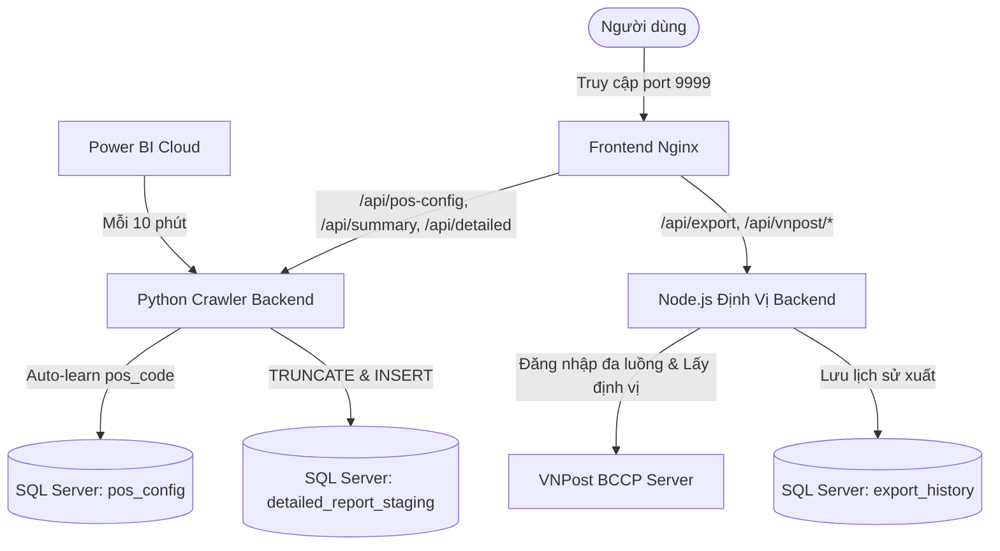

# Tool BDLD VNP (Bưu điện Lâm Đồng - VNPost)

Hệ thống quản lý, giám sát hàng tồn và tra cứu định vị bưu gửi chuyên biệt cho **Bưu điện tỉnh Lâm Đồng (VNPost)**. Tích hợp tự động crawl dữ liệu thời gian thực từ Power BI, hỗ trợ học tự động danh mục bưu cục, phân loại hàng tồn và định vị bưu gửi đa luồng song song qua hệ thống VNPost BCCP.

---

## 🚀 Các tính năng nổi bật

- 📊 **Dashboard Giám sát Hàng Tồn Thời Gian Thực:**
  - Tự động đồng bộ dữ liệu snapshot từ Power BI của Tổng công ty mỗi **10 phút**.
  - Tự động bóc tách và phân loại theo các khoảng thời gian tồn: `≥3 ngày`, `≥4 ngày`, `≥5 ngày`, `≥7 ngày`, `≥14 ngày`.
  - Tùy biến linh hoạt các cột thời gian tham gia tính **Tổng tồn toàn tỉnh**.
  - Đánh dấu màu nổi bật (Highlight) tự động theo ngưỡng số lượng bưu gửi tồn.

- 🏢 **Cơ chế Tự Động Học Bưu Cục Mới (Auto-learning POS):**
  - Tự động nhận diện bưu cục mới xuất hiện khi cào dữ liệu từ Power BI và lưu vào bảng `pos_config`.
  - **Quy tắc phân loại tự động:**
    - Bưu cục phát (`BCP...`): Tự động bật hiển thị (`is_active = 1`).
    - Bưu cục khai thác/trung chuyển (`BCKT...`): Tự động tắt hiển thị (`is_active = 0`).
  - **Bảo toàn cấu hình người dùng:** Hệ thống không ghi đè trạng thái bật/tắt mà người quản trị đã tùy chỉnh.
  - **Bộ lọc hiển thị toàn diện:** Dashboard, KPI tổng quan, bộ lọc dropdown và file xuất báo cáo chỉ hiển thị các bưu cục đang được kích hoạt.
  - **Giao diện cấu hình trực quan:** Tích hợp nút thao tác nhanh `[ 🏢 Cấu hình bưu cục ]` trên Dashboard và Tab riêng trong trang Cài đặt với các chức năng tiện ích: *Chỉ chọn BCP (Bỏ BCKT)*, *Chọn tất cả*, *Bỏ chọn tất cả*, tìm kiếm nhanh theo mã/tên.

- 🔍 **Chi tiết Bưu Cục Khai Thác & Trung Chuyển (BCKT Explorer):**
  - Cung cấp cửa sổ tra cứu riêng cho các bưu cục khai thác (KTC1, BCKT, KHL, GD).
  - Thống kê sản lượng và danh sách mã bưu gửi (`item_code`) chi tiết, giải thích nguyên nhân đọng ở khâu khai thác hoặc thiếu thông tin bưu tá.

- 🧵 **Tra Cứu Định Vị Bưu Gửi Đa Luồng (VNPost Multi-Session):**
  - Hỗ trợ tải dữ liệu định vị hàng ngàn bưu gửi đồng thời qua cơ chế chia lô (batching) và gộp Excel tự động.
  - Cho phép người dùng mở rộng đến **5 luồng song song** bằng cách giải captcha xác thực với BCCP.
  - Tự động khôi phục luồng và phân phối lại các lô bưu gửi khi có phiên hết hạn.

- 🛡️ **Kiểm Tra & Cảnh Báo Sức Khỏe URL Power BI:**
  - Tự động phát hiện `modelId` động qua API `modelsAndExploration`, loại bỏ hoàn toàn rủi ro thay đổi ID model từ Microsoft Power BI.
  - Hiển thị banner cảnh báo đỏ toàn màn hình kèm mã lỗi HTTP khi URL báo cáo hết hạn hoặc bị thu hồi quyền chia sẻ công khai.

- 👥 **Quản Trị Người Dùng & Phân Quyền Tập Trung:**
  - Đăng nhập hệ thống bảo mật bằng bcrypt, không bắt buộc Captcha khi truy cập ứng dụng.
  - Quản lý tài khoản, phân quyền (Admin / Nhân viên), giới hạn số luồng tra cứu cho từng cá nhân.
  - Hỗ trợ nhập danh sách tài khoản hàng loạt trực tiếp từ phần mềm VNPost BCCP.
  - Lưu trữ và tra cứu nhanh lịch sử các lần xuất file định vị.

---

## 📂 1. Cấu trúc thư mục dự án

```text
tools-bdld-vnp/
├── crawler-backend/             # Python Backend (Crawl dữ liệu từ Power BI & Quản lý POS)
│   ├── database.py              # Xử lý kết nối SQL Server, staging table & bảng pos_config
│   ├── main.py                  # API Server (FastAPI), phân quyền, filters, summary, pos-config
│   ├── pbi_crawler.py           # Kịch bản giả lập crawl dữ liệu từ Power BI API
│   ├── requirements.txt         # Thư viện Python (fastapi, pymssql, pandas, openpyxl, ...)
│   └── Dockerfile               # Cấu hình container Python
│
├── dinhvi-backend/              # Node.js Backend (Xử lý kết nối VNPost & xuất định vị)
│   ├── database.js              # Kết nối SQL Server lưu phiên người dùng & lịch sử xuất
│   ├── excel-helper.js          # Phân tích, xử lý và gộp dữ liệu định vị vào file Excel
│   ├── vnpost-client.js         # Client HTTP kết nối VNPost BCCP (login, captcha, tracking)
│   ├── server.js                # API Server (Express) điều phối đa luồng định vị
│   └── Dockerfile               # Cấu hình container Node.js
│
├── frontend/                    # Giao diện Web SPA (Dashboard hàng tồn + Định vị + Cấu hình)
│   ├── index.html               # Cấu trúc giao diện HTML5, modal cấu hình bưu cục, matrix
│   ├── app.js                   # Logic JavaScript (SPA navigation, state, POS config, filters)
│   ├── style.css                # Hệ thống CSS hiện đại (responsive, dark/light themes, badges)
│   ├── nginx.conf               # Cấu hình Nginx reverse proxy điều phối routing API
│   └── Dockerfile               # Cấu hình container Nginx Alpine
│
├── docker-compose.yml           # File deploy Stack chuẩn cho Portainer / Production
├── docker-compose.local.yml     # File deploy chạy local build từ source code
└── README.md                    # Tài liệu hướng dẫn sử dụng và triển khai hệ thống
```

---

## ⚙️ 2. Kiến trúc & Luồng hoạt động



### A. Tiến trình Crawl & Học bưu cục tự động
1. **Lịch trình:** Định kỳ 10 phút, tiến trình ngầm kiểm tra kết nối URL Power BI và cào dữ liệu báo cáo mới nhất.
2. **Khám phá Model động:** Gọi API `modelsAndExploration` của Power BI để lấy `modelId` mới nhất thời gian thực.
3. **Cập nhật Staging:** Dữ liệu mới được nạp vào bảng tạm `#detailed_report_staging_temp` và chuyển sang `detailed_report_staging`.
4. **Tự động học Bưu cục mới:**
   - Quét tất cả `pos_code` từ lần cào.
   - Nếu `pos_code` chưa có trong `pos_config`:
     - Bắt đầu bằng `BCP` -> Thêm mới với `is_active = 1, pos_type = 'BCP'`.
     - Bắt đầu bằng `BCKT` -> Thêm mới với `is_active = 0, pos_type = 'BCKT'`.
     - Loại khác -> Thêm mới với `is_active = 1, pos_type = 'OTHER'`.
   - Nếu `pos_code` đã tồn tại: Giữ nguyên trạng thái `is_active` mà người dùng đã cấu hình trước đó.

### B. Tra cứu định vị hàng loạt
1. Người dùng nhập danh sách mã bưu gửi trên giao diện Web (hỗ trợ copy-paste hoặc file).
2. Hệ thống chia nhỏ danh sách thành các lô (mặc định 50 - 500 mã/lô tùy cấu hình).
3. Các lô được phân phối song song cho các luồng VNPost đang hoạt động.
4. Dữ liệu phản hồi được gộp tự động thành file Excel định vị chi tiết trả về cho người dùng.

---

## 🌐 3. Danh mục API Endpoints

### 🐍 Python Backend (FastAPI - Cổng `8000`)

#### 🏢 Quản lý Bưu cục (POS Configuration)
- `GET /api/pos-config`: Lấy danh sách tất cả bưu cục (mã, tên, trạng thái kích hoạt, phân loại, sản lượng tồn hiện tại).
- `POST /api/pos-config`: Cập nhật trạng thái bật/tắt hiển thị (`is_active`) cho danh sách bưu cục.

#### 📊 Dashboard & Thống kê
- `GET /api/status`: Trạng thái hoạt động của crawler, thời gian crawl gần nhất, lỗi URL (nếu có).
- `GET /api/check-pbi-url`: Kiểm tra trực tiếp độ sẵn sàng của URL Power BI.
- `POST /api/trigger-crawl`: Kích hoạt cào dữ liệu Power BI thủ công.
- `GET /api/filters`: Danh mục bộ lọc dropdown (chỉ bao gồm các bưu cục có `is_active = 1`).
- `GET /api/summary`: KPI tổng hợp và bảng ma trận tồn đọng (đã lọc theo bưu cục active).
- `GET /api/bckt-summary`: Thống kê tổng hợp và danh sách bưu gửi tồn ở khâu khai thác/trung chuyển.
- `GET /api/detailed`: Danh sách chi tiết bưu gửi (hỗ trợ tìm kiếm, lọc bưu cục active, sắp xếp, phân trang).
- `GET /api/summary/export`: Xuất dữ liệu bưu gửi tồn ra file Excel.
- `GET /api/history`: Dữ liệu biến động lịch sử từ bảng `daily_snapshot` phục vụ vẽ biểu đồ.

#### 🔐 Xác thực & Quản trị tài khoản
- `POST /api/auth/login`: Đăng nhập hệ thống (xác thực mật khẩu local bcrypt).
- `GET /api/auth/me`: Lấy thông tin tài khoản đang đăng nhập.
- `POST /api/user/settings`: Đổi mật khẩu cá nhân hoặc cập nhật cookie VNPost.
- `GET /api/admin/users`: Danh sách tài khoản quản trị (*Admin*).
- `POST /api/admin/users`: Tạo tài khoản mới (*Admin*).
- `PUT /api/admin/users/{user_id}`: Cập nhật tài khoản, quyền hạn, giới hạn luồng (*Admin*).
- `DELETE /api/admin/users/{user_id}`: Xóa tài khoản (*Admin*).
- `POST /api/admin/import-users`: Nhập hàng loạt tài khoản từ danh sách copy của BCCP (*Admin*).

---

### 🟢 Node.js Backend (Express - Cổng `5000`)

#### 🔑 Đăng nhập VNPost & Quản lý Luồng
- `GET /api/auth/login-captcha`: Lấy Captcha và Cookie từ máy chủ VNPost BCCP.
- `POST /api/auth/login`: Đăng nhập tài khoản với VNPost qua Captcha để mở phiên.
- `GET /api/vnpost/sessions`: Kiểm tra số luồng đang mở và giới hạn luồng tối đa.
- `GET /api/vnpost/session-captcha`: Lấy mã Captcha để khởi tạo thêm luồng phụ.
- `POST /api/vnpost/add-session`: Gửi Captcha để kích hoạt thêm luồng mới (Luồng 2 -> 5).
- `POST /api/vnpost/reset-sessions`: Đặt lại danh sách luồng về mặc định (Luồng 1).
- `GET /api/vnpost/sessions-status`: Kiểm tra trạng thái kết nối sống của từng luồng.
- `POST /api/vnpost/refresh-session`: Giải captcha làm mới luồng bị hết hạn.

#### 📥 Tra cứu & Xuất dữ liệu định vị
- `POST /api/export`: Nhận danh sách mã bưu gửi, xử lý đa luồng và tải xuống file Excel định vị.
- `GET /api/history`: Lấy danh sách các lần xuất file trong lịch sử.
- `GET /api/history/download/{id}`: Tải lại file Excel đã xuất trong quá khứ.
- `GET /api/history/search`: Tra cứu nhanh hành trình của một mã bưu gửi trong kho lịch sử.

---

## 🛠️ 4. Danh sách Biến Môi Trường (Environment Variables)

| Biến môi trường | Dịch vụ áp dụng | Giá trị mẫu | Mô tả chi tiết |
| :--- | :--- | :--- | :--- |
| `DB_SERVER` | Crawler & Định vị | `10.61.200.10` | Địa chỉ IP hoặc Hostname máy chủ SQL Server |
| `DB_PORT` | Crawler & Định vị | `1433` | Cổng dịch vụ SQL Server |
| `DB_USER` | Crawler & Định vị | `sa` | Tên đăng nhập SQL Server |
| `DB_PASSWORD` | Crawler & Định vị | `******` | Mật khẩu truy cập SQL Server |
| `DB_NAME` | Crawler & Định vị | `caw_powerbi_db` | Tên cơ sở dữ liệu hệ thống |
| `POWERBI_URL` | Crawler Backend | `https://app.powerbi.com/view?r=...` | Đường dẫn Publish to Web của báo cáo Power BI nguồn |
| `DINHVI_BACKEND_URL` | Crawler Backend | `http://vnp-dinhvi-backend:5000` | URL kết nối nội bộ giữa 2 backend |
| `PORT` | Crawler Backend | `8000` | Cổng HTTP của Python FastAPI |
| `JWT_SECRET` | Định vị Backend | `vnpost-excel-exporter...` | Chuỗi khóa bí mật ký JSON Web Token |
| `FRONTEND_PORT` | Host / Docker | `9999` | Cổng truy cập Web giao diện người dùng |
| `TZ` | Tất cả dịch vụ | `Asia/Ho_Chi_Minh` | Múi giờ chuẩn Việt Nam |

---

## 🚀 5. Hướng dẫn Triển Khai (Deployment)

### A. Triển khai qua Portainer Stack (Khuyến nghị)

1. Đăng nhập vào giao diện **Portainer**.
2. Chọn **Stacks** -> Nhấn **Add stack**.
3. Đặt tên cho stack (ví dụ: `tools-bdld-vnp`).
4. Dán nội dung file [`docker-compose.yml`](file:///e:/dev/tools-bdld-vnp/tools-bdld-vnp/docker-compose.yml) vào trình soạn thảo Web editor:

```yaml
version: '3.8'

services:
  vnp-crawler-backend:
    image: ghcr.io/dong071102/tools-bdld-vnp-crawler-backend:latest
    container_name: vnp-crawler-backend
    restart: always
    environment:
      - DB_SERVER=10.61.200.10
      - DB_PORT=1433
      - DB_USER=sa
      - DB_PASSWORD=YourPasswordHere
      - DB_NAME=caw_powerbi_db
      - PORT=8000
      - TZ=Asia/Ho_Chi_Minh
      - DINHVI_BACKEND_URL=http://vnp-dinhvi-backend:5000
      - POWERBI_URL=https://app.powerbi.com/view?r=eyJrIjoiZTUwNjQ1NzgtODkzMy00ZmFjLWFiZmMtODE2OTFlZmM0MjFkIiwidCI6IjRkNmQ2N2FlLTViNTUtNDJhYy05ZGFhLTkzOTk3Yzc3YTg3YSIsImMiOjEwfQ%3D%3D
    networks:
      - bdld-vnp-network

  vnp-dinhvi-backend:
    image: ghcr.io/dong071102/tools-bdld-vnp-dinhvi-backend:latest
    container_name: vnp-dinhvi-backend
    restart: always
    environment:
      - DB_SERVER=10.61.200.10
      - DB_PORT=1433
      - DB_USER=sa
      - DB_PASSWORD=YourPasswordHere
      - DB_NAME=caw_powerbi_db
      - PORT=5000
      - TZ=Asia/Ho_Chi_Minh
      - JWT_SECRET=vnpost-excel-exporter-jwt-secret-key-2026-dynamic-secure
    networks:
      - bdld-vnp-network

  vnp-frontend:
    image: ghcr.io/dong071102/tools-bdld-vnp-frontend:latest
    container_name: vnp-frontend
    restart: always
    ports:
      - "9999:80"
    depends_on:
      - vnp-crawler-backend
      - vnp-dinhvi-backend
    networks:
      - bdld-vnp-network

networks:
  bdld-vnp-network:
    driver: bridge
```

5. Nhấn **Deploy the stack**.
6. Truy cập hệ thống tại: `http://<IP_SERVER>:9999` (hoặc domain cấu hình qua reverse proxy, ví dụ: `https://tools.bdld.io.vn`).

---

### B. Triển khai bằng Docker Compose (Command Line)

```bash
# 1. Sao chép và cấu hình biến môi trường
cp .env.example .env

# 2. Khởi chạy hệ thống (tải pre-built image mới nhất từ GHCR)
docker compose pull
docker compose up -d

# 3. Xem nhật ký hoạt động (Logs)
docker compose logs -f
```

---

### C. Cập nhật phiên bản mới (Update Image)

Khi có bản cập nhật mới trên GitHub (`main`), hệ thống CI/CD GitHub Actions sẽ tự động build image `:latest`. Để cập nhật dịch vụ đang chạy:

1. **Trên Portainer:**
   - Vào mục **Stacks** -> Chọn `tools-bdld-vnp`.
   - Bấm vào service (ví dụ `vnp-crawler-backend` hoặc `vnp-frontend`).
   - Nhấn **Recreate** -> Bật tùy chọn **Re-pull image** -> Bấm **Recreate**.
2. **Trên Command Line:**
   ```bash
   docker compose pull
   docker compose up -d
   ```

---

## 🔒 6. Tài khoản quản trị mặc định

- **Tên đăng nhập:** `lamdong`
- **Mật khẩu khởi tạo:** `Lamdong@2026`
- **Vai trò:** Quản trị viên (`admin`)
- *Lưu ý: Quản trị viên nên đổi mật khẩu ngay sau lần đăng nhập đầu tiên trong mục Cài đặt hệ thống.*

---

## 📄 7. Bản quyền & Giấy phép

Hệ thống được thiết kế và xây dựng dành riêng cho công tác quản lý, điều hành phát hàng và định vị bưu gửi tại **Bưu điện tỉnh Lâm Đồng - Tổng công ty Bưu điện Việt Nam (VNPost)**.
